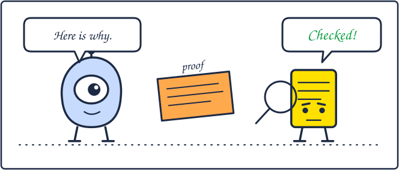
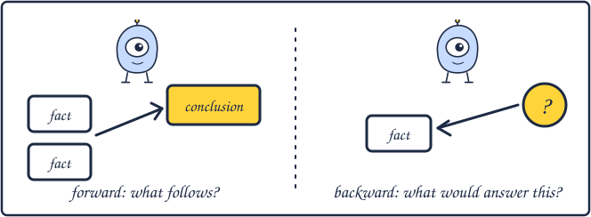
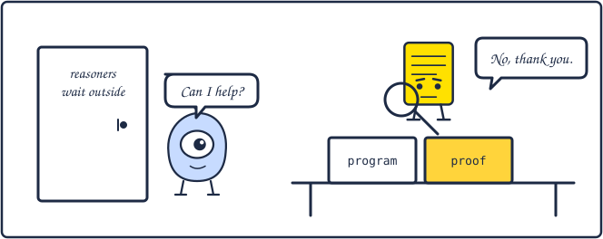
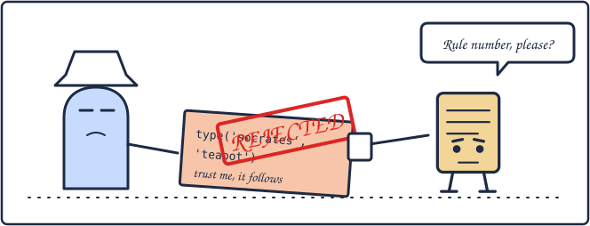
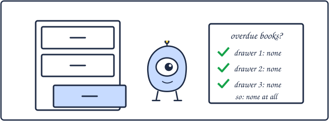

# The Art of eyemind

*A pocket book in eight short chapters: how a small reasoner turns rules into
conclusions you do not have to take on faith, and why that matters more, not
less, now that machines write so fluently.*



*Meet Mind, who reasons, and Checker, who never takes Mind's word for anything.*

eyemind is open source, written in plain JavaScript, with no dependencies. It
runs on the command line, as a library and in a browser tab.

1. [One assembler, many languages](#one-assembler-many-languages)
2. [Small rules, sure conclusions](#small-rules-sure-conclusions)
3. [A proof you can hand to a stranger](#a-proof-you-can-hand-to-a-stranger)
4. [The forger's bad day](#the-forgers-bad-day)
5. [Proving that something is not there](#proving-that-something-is-not-there)
6. [Honest numbers](#honest-numbers)
7. [eyemind in a world with AI](#eyemind-in-a-world-with-ai)
8. [The art, in seven maxims](#the-art-in-seven-maxims)

## One assembler, many languages

People describe knowledge in many ways. Web data speaks RDF and its rule
language N3. Database people write SPARQL. Lawyers and policy makers would
rather write plain sentences. Ontologies, data shapes, units of measure and
usage policies each have their own standards.

eyemind does not ask anyone to give up their language. It asks something
smaller: that each language be **compiled to Logic Script (LS)**, the way a
programming language is compiled to the instructions of a processor. LS is
the assembler level for rule languages. Once a language compiles to it, one
engine runs it and one checker verifies its proofs.



*Many front ends, one instruction set underneath.*

This pays off twice. A new language does not need its own engine to get
reasoning and checkable proofs; it only needs a compiler to LS. And because
every conclusion lands in the same language, an N3 rule, a SPARQL rule and a
sentence in Logical English can be checked the same way.

## Small rules, sure conclusions

LS programs are written with JavaScript syntax, so there is nothing new to
install or parse. Here is the smallest complete program: two facts, one rule
and a question.

```js
// Socrates is human, and every human is mortal.
fact(type('socrates', 'human'))
fact(subclass_of('human', 'mortal'))
implies([type(S, A), subclass_of(A, B)], type(S, B))

query(type(X, Y))
```

eyemind answers `type('socrates', 'mortal')` and `type('socrates', 'human')`.
Capitalised names are variables; an array is read as "and". Nothing in the
answer is a guess: each conclusion follows from the rules and facts you gave.

Mind can reason in two directions. Going **forward**, it starts from what it
knows and works out everything that follows, like a detective collecting
clues. Going **backward**, it starts from a question and looks only for what
would answer it. eyemind uses both, and each can call the other.



*Forward collects, backward searches; eyemind does both in one program.*

## A proof you can hand to a stranger

Most software gives you an answer and, at best, a log you have to trust.
eyemind can give you a **proof**: a document that says which rule produced
each conclusion from which facts, citing the rules of your program by number.

The proof is checked by a separate procedure, the checker. The checker reads
only two things: your program and the proof. It never runs the reasoner to
fill a gap. If the proof skips a step, leans on a rule that is not in the
program, or claims an answer it cannot justify, the check fails.



*The checker works from the paper alone. That is the whole trick.*

Because the checker is small and independent of the engine, the proof can
travel. You can send a conclusion to an auditor, a regulator or a business
partner who does not trust your software, and they can check it themselves.
Every proof eyemind produces is checked before it is returned; if a proof
cannot be made checkable, eyemind refuses to certify the answer rather than
hand over something unchecked.

```sh
eyemind --proof socrates.js > proof.js
eyemind --check-proof proof.js socrates.js   # reports: checked
```

## The forger's bad day

A proof is only worth something if a fake one fails. So the rule in eyemind
is strict: **a forged proof must never be reported as checked**. The test
suite forges proofs on purpose, at random, and every one of them has to be
rejected.



*A claim with no rule behind it does not get a stamp.*

The checker also refuses proofs that say too much or too little. The claimed
answers must be exactly the answers the program gives. A step that nobody
needs, a table nobody consults, or a missing answer all make the check fail.

## Proving that something is not there

"Is there an unpaid invoice?" "No." Saying no is harder than saying yes. To
prove something exists you show it; to prove nothing matches, you must show
that you looked everywhere it could be.

Rules often depend on such absences: a member with no overdue books may
borrow, a request no policy forbids may go ahead. eyemind supports these
rules, and their proofs include **complete answer tables**, so the checker can
confirm that the search really was exhaustive. The same goes for counting and
totals: a sum is only right if no item was left out.



*"Nothing" is a conclusion too, and it deserves evidence.*

## Honest numbers

In LS a number keeps its type. Adding the binary64 floats `0.1` and `0.2`
with `add(0.1, 0.2)` gives `0.30000000000000004`. Integers are exact however
large they get, and LS keeps integer and float arithmetic separate. In SPARQL
RL, `xsd:decimal` uses an integer coefficient and a power of ten. Adding
decimal `0.1` and `0.2` gives exactly `0.3`, and the proof checker recomputes
that sum with integers alone.

The QUDT profile uses its unit catalogue to normalize a reading such as
micrograms per cubic metre to kilograms per cubic metre. The profile reports
an unresolved unit, such as a currency, on a quantity value.


*Floats behave as floats, decimals and integers stay exact.*

## eyemind in a world with AI

Large language models are wonderful at language. They read a regulation, a
contract or a messy dataset and suggest what it means, in seconds. But they
produce what is *likely*, not what is *entailed*, and they cannot show you a
derivation that someone else can check line by line.

eyemind is built for the other half of the job. The two fit together like a
writer and a mathematician.



*The model drafts, eyemind decides and proves, anyone can check.*

- **AI drafts, rules decide.** A model can turn a policy into Logical English
  sentences or LS rules. People review those rules, which are short and
  readable. eyemind then applies them to the data, the same way every time.
- **Models already speak the language.** LS is written with JavaScript syntax,
  which language models read and write fluently, and its conclusions are plain
  data. No exotic notation stands between a model and a correct program.
- **Evidence instead of eloquence.** An AI agent that acts on someone's behalf
  can attach an eyemind proof to its decision: this request is permitted under
  this policy, because of these facts. The receiving side checks it without
  trusting the agent or its maker.
- **Permissions with a paper trail.** With the ODRL profile, eyemind evaluates
  usage policies: who may use which data, for what, under which duties. As
  agents trade data and services, those yes-or-no answers need to be
  explainable.
- **Rules for streams.** Sensors and services send small RDF messages all
  day long. The shape-planning example uses SHACL shapes to describe those
  messages and the desired output. eyemind prepares specialized OWL 2 RL
  rules before it processes the first message, then reuses them for messages
  of the same shape.
- **Many independent implementations.** LS has a written
  [specification](https://eyereasoner.github.io/eyemind/LS-SPEC) and a
  black-box [conformance suite](https://eyereasoner.github.io/eyemind/conformance/),
  so others can build their own engine and checker. When independent tools
  agree on a proof, nobody has to trust a single vendor, whether that vendor
  is a person or a model.

Put simply: as more of the world's text is written by machines, the value of
a conclusion that **someone else can check** goes up. Fluency is becoming
cheap. Evidence is not.

## The art, in seven maxims

1. **Keep your language; share the assembler.** N3, SPARQL RL and Logical
   English already compile to LS, and any rule language that does gets the
   same engine and checker.
2. **State facts and rules, not procedures.** Say what is true; let the
   reasoner work out what follows.
3. **Show your work.** A conclusion with a proof travels further than one
   without.
4. **Let someone else check.** The checker reads the proof and the program,
   never the reasoner's mind.
5. **Prove the "no" as well as the "yes".** Absence and totals need complete
   evidence.
6. **Keep types honest.** Numbers and units should mean exactly what they say.
7. **Refuse rather than bluff.** If it cannot be proven, eyemind says so.


*At the end of the day, Mind and Checker share one proof and watch the sun go down: reasoning and checking, better together.*

---

**Try it.** Open the [playground](https://eyereasoner.github.io/eyemind/playground/)
in a browser, browse the [examples](https://eyereasoner.github.io/eyemind/examples/),
or install the command with `npm install --global eyemind`. The
[specification](https://eyereasoner.github.io/eyemind/LS-SPEC) and
[conformance suite](https://eyereasoner.github.io/eyemind/conformance/) are
there for anyone who wants to build their own. For rules in plain English,
read the companion [The Art of Logical English](https://eyereasoner.github.io/eyemind/LE-BOOK).
