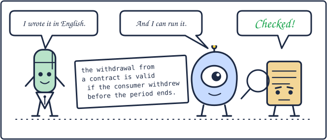
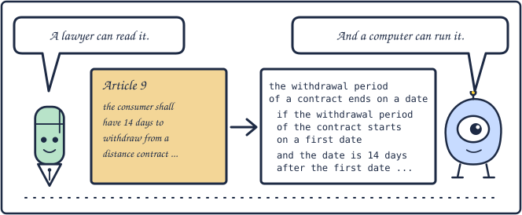
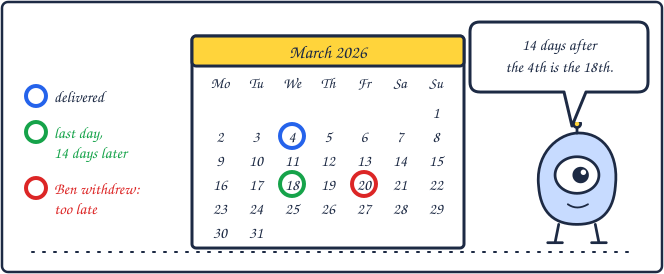
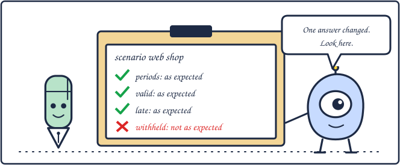
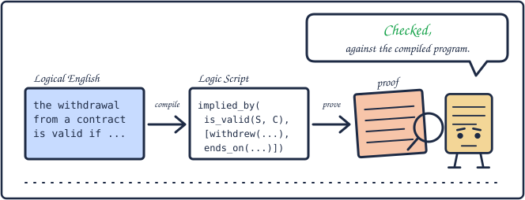
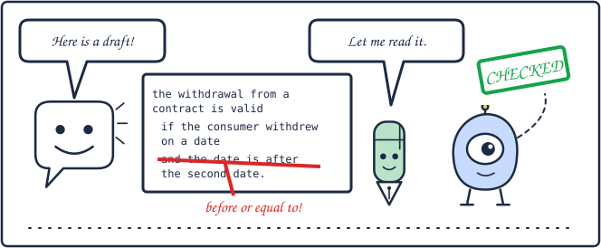
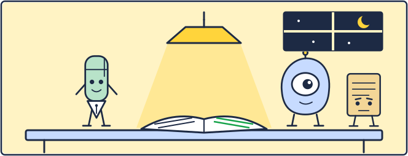

# The Art of Logical English

*A pocket book in eight short chapters: how rules written in plain English
become programs that eyemind runs, with answers anyone can check.*



*Meet Quill, who drafts the rules. Mind, who reasons, and Checker, who never
takes Mind's word for anything, are old friends from
[The Art of eyemind](https://eyereasoner.github.io/eyemind/BOOK).*

[Logical English](https://github.com/LogicalContractsOrg/LogicalEnglish) (LE)
is the controlled natural language of Robert Kowalski, Jacinto Dávila, Miguel
Calejo, Galileo Sartor and their colleagues for writing legal and business
rules as English that a computer runs. eyemind reads `.le` files, compiles them
to Logic Script (LS), and answers their questions with proofs.

The examples also use Logical English for science, technology, engineering
and mathematics. These programs use templates and rules to model ABO blood
group inheritance, calculate the molar mass of glucose, and find the critical
path of a house build. Euclid's algorithm and the Pythagorean theorem show
how rules express integer arithmetic and comparisons.

This book follows one example from start to finish: a web shop deciding on
withdrawals from online purchases under the EU Consumer Rights Directive. The
whole program is
[consumer-withdrawal-le.le](https://github.com/eyereasoner/eyemind/blob/main/examples/consumer-withdrawal-le.le),
and you can run it in the
[playground](https://eyereasoner.github.io/eyemind/playground/#example=consumer-withdrawal-le).

1. [English that runs](#english-that-runs)
2. [Templates: the words of a domain](#templates-the-words-of-a-domain)
3. [Rules that read like the law](#rules-that-read-like-the-law)
4. [Exceptions, and showing that none applies](#exceptions-and-showing-that-none-applies)
5. [Days, deadlines and sums](#days-deadlines-and-sums)
6. [Scenarios: test cases in the same document](#scenarios-test-cases-in-the-same-document)
7. [From sentences to a checked proof](#from-sentences-to-a-checked-proof)
8. [Logical English in a world with AI](#logical-english-in-a-world-with-ai)

## English that runs

Laws, contracts and policies are written in English for people. Programs are
written in code for computers. Between the two sits a translation, done by a
programmer, that the lawyer who knows the rules cannot easily read. When the
rule changes, or someone asks why a decision came out as it did, that
translation is where the trouble starts.

Logical English removes the gap. A rule is an English sentence with a little
discipline: a conclusion, the word `if`, and conditions joined by `and` and
`or`. A lawyer can read it as a sentence. A computer can run it as a logic
program. It is the same text for both.



*One text, two readers: the lawyer and the machine.*

The discipline is light. There are no brackets to balance and no symbols to
learn. Variables are written as English phrases such as `a contract` and
`the contract`. Rules keep the order and the wording of the law they come from, so
a reviewer can lay the rule next to the article and compare them line by line.

## Templates: the words of a domain

A Logical English document starts by declaring its vocabulary: the
**templates** of the sentences it will use. Each template is a sentence with
places, written between asterisks.

```text
the templates are:
    the consumer withdrew from *a contract* on *a date*,
    the withdrawal period of *a contract* ends on *a date*,
    the right of withdrawal from *a contract* is excluded by *an article*,
    the trader must refund *an amount* for *a contract* by *a date*.
```

A sentence fills the places:
`the consumer withdrew from the jacket order on 2026-03-20.`
is a fact of the first template. The words outside the places are
fixed. The words inside the places are the things the sentence talks about: a
contract, a date, an amount.


*A template is a form; each fact fills in its blanks.*

Templates are where the domain's experts and the program meet. Choosing them
is choosing what the rules can talk about, and the choice is made in words
those experts already use.

## Rules that read like the law

A rule is a sentence of a template, followed by `if` and its conditions.
Article 9(2) of the Directive says that, for goods, the withdrawal period
starts on the day the consumer gets them. In Logical English:

```text
the withdrawal period of a contract starts on a date
    if the contract is a sales contract
    and the goods of the contract were delivered on the date.
```

`a contract` introduces a variable; `the contract` refers to it again. A
second rule says that for a service, the period starts on the day the contract
is concluded. Two rules for one conclusion are two alternatives, as two
paragraphs of a law are.

Indentation matters, as it does on a lawyer's page: conditions indented
deeper bind tighter, so `or` and `and` combine the way the layout shows. A
rule can be written with its conditions numbered, as statutes do, with
`either:` and `all of:` grouping them.

Each rule in the example carries a comment that names its article. The rules
can be compared with the Directive article by article.

## Exceptions, and showing that none applies

Laws are full of exceptions. Article 16 of the Directive lists contracts
without a right of withdrawal: goods made to the consumer's specifications,
sealed hygiene goods unsealed after delivery, a service fully performed after
the consumer agreed to lose the right, and more. Logical English writes an
exception as a rule of its own and a negation where it applies:

```text
the right of withdrawal from a contract is excluded by "Article 16(c)"
    if the goods of the contract were personalised for the consumer.

the withdrawal period of a contract ends on a date
    if ...
    and it is not the case that
        the right of withdrawal from the contract is excluded by an article.
```

`it is not the case that` holds when no exception can be found. That is a
strong claim: it says that every exception was considered and none applied.
eyemind's proofs back it up with complete tables of what the program can
conclude, so the checker confirms that the search for an exception really was
exhaustive.


*No exception applies only when every exception has been checked.*

The engraved ring is personalised, so its right of withdrawal is excluded by
Article 16(c), and its withdrawal period never starts to run. The jacket
passes all three exceptions, so its period runs.

## Days, deadlines and sums

Legal rules count days. A Logical English date is written `2026-03-04`, and
the built-in template `is 14 days after` counts calendar days in both
directions: given any two of its dates and days, it works out the third.

```text
the withdrawal period of a contract ends on a date
    if the withdrawal period of the contract starts on a first date
    and the trader informed the consumer of the right of withdrawal from the contract on a second date
    and the second date is before or equal to the first date
    and the date is 14 days after the first date
    and ...
```

Dates compare with `is before`, `is after` and `is before or equal to`. A
withdrawal sent on or before the last day is valid; one sent later is too
late.



*Ben's jacket arrived on the 4th; he withdrew on the 20th, two days too late.*

Money is added up the same way a person would describe it. The refund is
every payment the consumer made, delivery included:

```text
the amount is the sum of each payment such that
    the contract charged the payment for a charge.
```

The sum, count, average, minimum and maximum collect every solution of their
condition. Like the negation, they only give the right answer when nothing
was missed, and the proof shows the complete table they were taken from.
Integers stay exact however large they get.

## Scenarios: test cases in the same document

A Logical English document can carry its own test cases. A **scenario** states
facts about one situation, and the answers its queries are expected to give:

```text
scenario web shop is:
    the jacket order is a sales contract.
    the goods of the jacket order were delivered on 2026-03-04.
    the consumer withdrew from the jacket order on 2026-03-20.
    ...
    late expects answers ["the withdrawal from the jacket order is too late"].

query late is:
    the withdrawal from which contract is too late.
```

eyemind answers every query in every scenario and compares the answers with
the expectations. When a rule or a fact changes an answer, the output says so
at once. Add that the coffee machine was sent back, and the shop may no longer
withhold Eva's refund:

```text
% query withheld with scenario web shop
% no answers
% not as expected: withheld expects answers ["the trader may withhold the refund for the coffee machine order"]
```



*Expected answers turn a scenario into a test that anyone can read.*

Scenarios are how lawyers test rules without learning a test framework. They
write down a case and the outcome they expect, in the same sentences the rules
use.

## From sentences to a checked proof

eyemind does not run English directly. It **compiles** each Logical English
document to an ordinary LS program, just as it compiles Notation3 and SPARQL
rules. The rule for a valid withdrawal becomes a backward LS rule. Simplified,
it reads:

```js
implied_by(
  the_withdrawal_from_is_valid(Scenario, Contract),
  [the_consumer_withdrew_from_on(Scenario, Contract, Date),
   the_withdrawal_period_of_ends_on(Scenario, Contract, SecondDate),
   or(compare('<', Date, SecondDate), compare('=', Date, SecondDate))])
```

Every relation takes the scenario as its first argument, so one program and
one proof answer every query in every scenario. `--program` prints the whole
compiled program, and `--proof` writes a proof of its answers.



*Sentences become rules, rules give answers, answers come with a proof.*

```sh
eyemind consumer-withdrawal-le.le                          # answers as sentences
eyemind --proof consumer-withdrawal-le.le > proof.js
eyemind --check-proof proof.js consumer-withdrawal-le.le   # reports: checked
eyemind --explain consumer-withdrawal-le.le                # answers explained in English
```

The same checked proof also explains each answer in English. `--explain`
writes the answer, then `because` and every condition it rests on, each
explained in turn on the lines below it:

```text
the withdrawal from the coffee machine order is valid
    because the consumer withdrew from the coffee machine order on 2026-04-20
    and the withdrawal period of the coffee machine order ends on 2026-04-24
        because the withdrawal period of the coffee machine order starts on 2026-03-04
            because the coffee machine order is a sales contract
            and the goods of the coffee machine order were delivered on 2026-03-04
        and the trader informed the consumer of the right of withdrawal from the coffee machine order on 2026-04-10
        and 2026-04-10 is after 2026-03-04
        and 2026-04-24 is 14 days after 2026-04-10
        and it is not the case that the right of withdrawal from the coffee machine order is excluded by an article
    and 2026-04-20 is before 2026-04-24.
```

The explanation is written in the templates' own words, so the reader who
reviewed the rules can follow the decision without reading the proof.

The checker reads the proof against the compiled program. It never runs the
reasoner to fill a gap, and it rejects a forged proof. A checked proof
establishes the answers under the compiled rules. That the compiled rules say
what the English says is a matter of the compiler and its tests, which is one
more reason to keep the English close to the law it comes from: the step from
the law to the sentences is the one people review.

## Logical English in a world with AI

Language models read a regulation in seconds and can draft its rules just as
fast. They also make mistakes that read fluently: a condition reversed, an
exception forgotten, a deadline counted from the wrong day. In code, such a
mistake hides from the lawyer who could spot it. In Logical English, it sits
in a sentence the lawyer can read.



*The model drafts, the lawyer reviews, eyemind decides and proves.*

- **AI drafts, people review.** A model turns an article into Logical English
  sentences. A lawyer reads them against the article, as Quill does, and
  corrects them in the same words.
- **Scenarios pin the meaning down.** Expected answers written by people catch
  a draft that reads well but decides wrongly, every time the rules change.
- **Decisions with evidence.** An AI agent that decides for someone can attach
  the proof of its answer: this withdrawal is valid under these articles,
  because of these facts. The other side checks it without trusting the agent.
- **One assembler underneath.** Logical English compiles to LS, like N3 and
  SPARQL rules do, so rules from all of them share one engine and one
  checker.

Fluency is becoming cheap. A rule that a lawyer can read, a machine can run,
and anyone can check is not.

---

## The art, in seven maxims

1. **Write the rule as its source says it.** Keep the order and wording where
   you can, and cite the article, clause or theorem it comes from.
2. **Choose templates with the people who know the domain.** They are its
   vocabulary.
3. **One provision, one rule.** Alternatives are separate rules; exceptions
   are rules of their own.
4. **Say "no" with evidence.** A negation, a sum or a count is only right when
   nothing was missed.
5. **Count days with dates, not with guesses.** Let the calendar do the
   arithmetic.
6. **Put the expected answers in the document.** A scenario is a test case
   anyone can read.
7. **Let someone else check.** A checked proof travels further than an
   answer.



*At the end of the day, Quill, Mind and Checker read one book: the rules on
one page, the proof on the other.*

---

**Try it.** Open the
[consumer withdrawal example](https://eyereasoner.github.io/eyemind/playground/#example=consumer-withdrawal-le)
in the playground, read its
[card deck](https://eyereasoner.github.io/eyemind/examples/deck/consumer-withdrawal-le),
or browse the [examples catalog](https://eyereasoner.github.io/eyemind/examples/).

- Science examples cover [ABO blood groups](https://eyereasoner.github.io/eyemind/examples/deck/blood-groups-le)
  and [molar masses](https://eyereasoner.github.io/eyemind/examples/deck/molar-mass-le).
- The engineering example finds the [critical path of a house build](https://eyereasoner.github.io/eyemind/examples/deck/critical-path-le).
- Mathematics examples cover [Euclid's algorithm](https://eyereasoner.github.io/eyemind/examples/deck/euclid-le)
  and the [Pythagorean theorem](https://eyereasoner.github.io/eyemind/examples/deck/pythagoras-le).
- Law examples cover [British citizenship](https://eyereasoner.github.io/eyemind/examples/deck/british-citizenship-le)
  and [inheritance without a will](https://eyereasoner.github.io/eyemind/examples/deck/intestate-succession-le).

See the [Logical English reference](https://eyereasoner.github.io/eyemind/LE-SPEC)
for the syntax eyemind reads and the Logic Script it compiles to.
